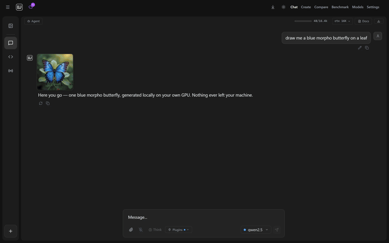
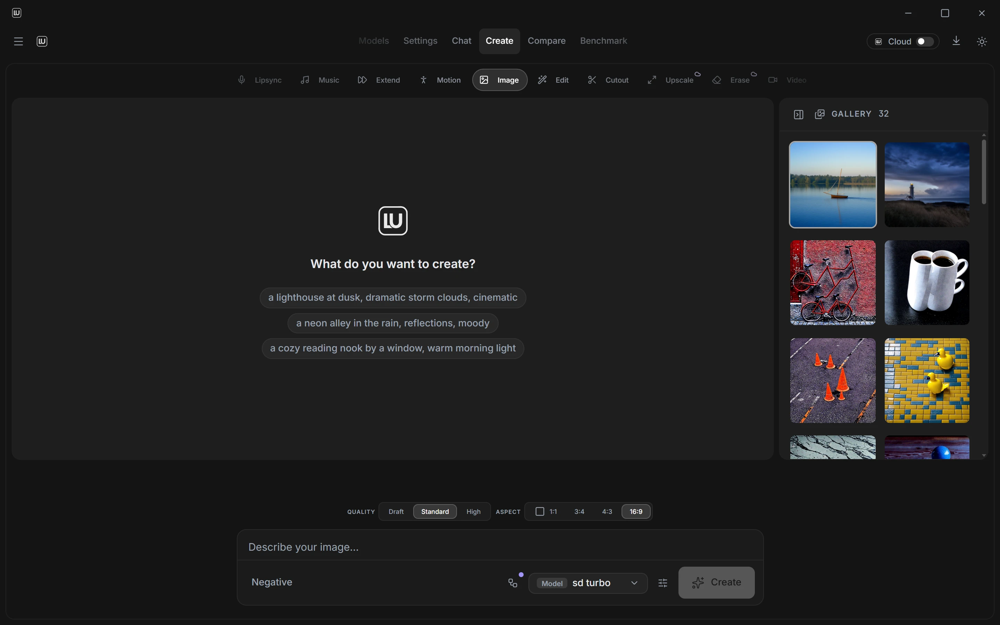

Want stuff for WSL look here - https://github.com/vinberg88/

<div align="center">


# Locally Uncensored

**The all-in-one local AI studio for your desktop. Chat, images, video and a coding agent in one app. Install it, pick a model, go.**

Free and open source. In local mode everything runs on your own machine. No Docker, no terminal, no config files. The platforms are listed under [Download](#download).

[](https://www.gnu.org/licenses/agpl-3.0)
[](https://github.com/PurpleDoubleD/locally-uncensored/stargazers)
[](https://github.com/PurpleDoubleD/locally-uncensored/commits)
[](https://scorecard.dev/viewer/?uri=github.com/PurpleDoubleD/locally-uncensored)
[](https://github.com/PurpleDoubleD/locally-uncensored/actions/workflows/codeql.yml)
[](https://github.com/PurpleDoubleD/locally-uncensored/discussions)
[](https://locallyuncensored.com/discord)
[](https://locallyuncensored.com)



[Download](#download) · [Three steps](#three-steps) · [What is in the box](#what-is-in-the-box) · [How it compares](#how-it-compares) · [Models](#models-that-run-well) · [FAQ](#faq)

| Chat that draws your images | Images and video in the same window |
|:---:|:---:|
|  |  |
| **The coding agent shows the diff first** | **Agent mode does the legwork** |
|  |  |

</div>

---

## Download

Take the latest build from [Releases](https://github.com/PurpleDoubleD/locally-uncensored/releases/latest).

| Platform | File | Status |
|----------|------|--------|
| Windows 10 and 11 | [`Locally.Uncensored_3.0.8_x64-setup.exe`](https://github.com/PurpleDoubleD/locally-uncensored/releases/latest/download/Locally.Uncensored_3.0.8_x64-setup.exe) (NSIS, recommended) or [`Locally.Uncensored_3.0.8_x64_en-US.msi`](https://github.com/PurpleDoubleD/locally-uncensored/releases/latest/download/Locally.Uncensored_3.0.8_x64_en-US.msi) | Tested every release, signed auto update channel |
| Linux | [`Locally.Uncensored_3.0.8_amd64.AppImage`](https://github.com/PurpleDoubleD/locally-uncensored/releases/latest/download/Locally.Uncensored_3.0.8_amd64.AppImage), [`Locally.Uncensored_3.0.8_amd64.deb`](https://github.com/PurpleDoubleD/locally-uncensored/releases/latest/download/Locally.Uncensored_3.0.8_amd64.deb) or [`Locally.Uncensored-3.0.8-1.x86_64.rpm`](https://github.com/PurpleDoubleD/locally-uncensored/releases/latest/download/Locally.Uncensored-3.0.8-1.x86_64.rpm) | Built on every release |
| macOS 14 or newer, Apple Silicon (Beta) | [`LU_3.0.8_aarch64.dmg`](https://github.com/PurpleDoubleD/locally-uncensored/releases/latest/download/LU_3.0.8_aarch64.dmg) | Signed with an Apple Developer ID and notarized by Apple. Intel Macs are not supported. The app has run on one Mac so far. Voice has been tried by hand in the app on a Mac and works. Computer control is in the Mac app but not fully tested yet on macOS. Remote Access and the automatic update are not confirmed on macOS |
| Android 7.0 or newer (arm64) | [`LU-3.0.7-Android.apk`](https://github.com/PurpleDoubleD/locally-uncensored/releases/download/v3.0.7/LU-3.0.7-Android.apk) | The phone app. Not in the Play Store yet: install the file from this page. SHA-256 `2f4e2c60f2edde2705c31ca324b5ba952a84efa8eec3075f4f45f2a29a806fb6` |

<!-- MAC: the macOS row above is the one place in this file that says whether there is a Mac build. This is the Mac version of the row. It is true only for the .dmg that the release run built, signed and notarized, so it goes out after that run is green. -->

Some antivirus engines flag unsigned NSIS installers that download other binaries, which is a false positive. The installer is built by GitHub Actions from the public source on `master`, and the update channel is signed against a public minisign key, so you can verify both: see [SECURITY.md](SECURITY.md#antivirus--browser-false-positives).

Code signing for the Windows installers: free code signing provided by [SignPath.io](https://about.signpath.io), certificate by [SignPath Foundation](https://signpath.org). SignPath Foundation has accepted the project. The production certificate is not in place yet, and until it is the installers ship unsigned.

Current release: **v3.0.8** (October 2026). Every change since 1.0.0 is in [CHANGELOG.md](CHANGELOG.md).

3.0.8 makes web search in the chat work again: LU asks five search services in turn and needs no key for any of them. A video made in the chat plays in the chat, and a long one renders in the background while you write on. A picture attached in the chat reaches the image tool, and with two graphics cards chat and ComfyUI can each get their own. The LU Engine plans a model's memory from the file itself and offers a shorter context with one click. AMD cards on Windows get AMD's current ROCm build. New: the chat can read and change LU's settings with a confirmation card, the Model Manager can make a copy of a local model that refuses less, and Settings, Storage puts models, gallery and runtime in one folder of your choice. What has only run in automated tests is listed under Known limits in the [CHANGELOG](CHANGELOG.md).

3.0.7 brings REA (Reverse Engineer Anything) as a plugin: switch it on under Plugins in the desktop app, and Agent and Code can take apart apps and files (it needs Node.js and works best with a model of about 27B and 64K context; a full analysis has run on one Mac so far, and on Windows it has started from the built app). LU Cloud now has DeepSeek V4.1 Flash 1017, ready to pick in Chat. A chat can be duplicated or branched from any message, character cards turn into personas with their greeting, a persona can carry a reminder, group chats got a round of fixes, and auto compact is on by default. A character you trained works in every part of Create and in chat, and a Mac can train one too. ComfyUI workflows import the way ComfyUI saves them, a whole folder at once, with the node packs they need, and LU now uses the shared model folders set in ComfyUI. In Create, Edit takes as many reference images as the graphics memory holds (up to ten on a Mac), Enhance Image runs on your own machine, and on a Mac Talking Character, Motion Control, Music, Enhance Image, Remove Background and masks in Edit run locally. There is an Android app now, see [Mobile app](#mobile-app-android-iphone) below. The iPhone app is in review at the App Store. Some of it has only been checked in tests so far; the [CHANGELOG](CHANGELOG.md) says which.

3.0.5 was about Create: LTX 2.5, FastH3 and YuE2 run on your own machine, Qwen-Image 2.1 gets a transparent background and its prompt enhancer, Edit, Remove Background and Enhance Image take up to 50 images in one go, and LU Cloud adds Qwen Image 2.1, LTX 2.5, MiniMax H3 and Wan 3.0 Reference. Chat takes any file, each model in a group chat can have its own persona, dropdowns stay inside the window (issue 149), and the speech install works again on Ubuntu 24.04.

3.0.4 fixed the Code agent and the agent in chat on LU Cloud: writing a long file no longer ends the run, "continue" picks up where a run stopped instead of starting over, the agent keeps a plan only when you ask for one, and cloud context is 32K by default and can be set per model. It also fixed the bugs reported on GitHub and Discord since 3.0.3 (issues 144 to 147): MiniMax H3 runs as a video model with sound, Edit takes up to three extra images with Qwen-Image 2.1, a missing encoder or VAE is named and offered as a download instead of ending in "Value not in list", the LoRA stack follows the loras folder, and group chat works with every LU Engine model.

3.0.3 was a hotfix: chats with many images no longer run the app out of memory, Create reads a model's family from the file instead of its name, and the five bugs reported on GitHub since 3.0.2 are fixed (issues 139 to 143).

3.0.2 was a hotfix: the Code tab lost its scrollbar and its input box once a conversation grew taller than the window (issue 138, a regression in 3.0.1) and is held to the window height again, and the count of open cloud models now takes the Create Studio endpoints in, which makes it fourteen video models and seven image models.

### What is new in 3.0.1

- **Qwen-Image 2.1 runs locally on Windows and Linux.** One model generates a picture from a prompt and edits one from a reference image, with no mask to paint. About 16 GB of files, ComfyUI 0.37.0 or newer, and a research license that does not allow commercial use.
- **Models has a LoRAs tab of its own.** Search CivitAI, download into ComfyUI's `models/loras` folder, see what is installed with its size and trigger word, and delete what you no longer want.
- **A GPU whose free memory could not be measured is planned more carefully**, and the log now says total capacity instead of calling it free.
- **The Linux AppImage stops handing its own runtime to every program LU starts**, so a healthy system Python, pip, git or ffmpeg keeps working, and a distribution that blocks pip in the system Python keeps the isolated environment LU built.
- **The local model runs one conversation at a time and says so**, with a line showing how many chats are ahead. Stop works while a chat is still waiting.
- **Temperature, Top P and Max tokens belong to the conversation you moved them in**, instead of every open chat sharing one value.
- **Cloud video renders offer the clip lengths the picked model really supports**, read from the live catalog.

## Mobile app (Android, iPhone)

LU is also available as an app for your phone. The current APK comes from the 3.0.7 release.

- **Android:** download `LU-3.0.7-Android.apk` from the [3.0.7 release](https://github.com/PurpleDoubleD/locally-uncensored/releases/tag/v3.0.7). Needs Android 7.0 or newer on a 64-bit (arm64) phone. Allow installing apps from your browser or file app when Android asks. SHA-256: `2f4e2c60f2edde2705c31ca324b5ba952a84efa8eec3075f4f45f2a29a806fb6`
- **iPhone:** in review at the App Store.
- **Google Play:** coming later.

What the app does:
- Run AI models on your phone and chat offline. Chats with on-device models stay on the phone.
- Ask questions about your own documents. Memory and personas.
- Optional LU Cloud with your account: larger hosted chat models, Create (images and video) and dictation.
- Connect to LU on your own computer over your home Wi-Fi and chat with the models on your PC.

Later APKs install over this one and keep your data. The Google Play version will be signed by Google: to switch to it, export your chats first (Settings, Data) and uninstall the APK.

## Three steps

1. **Install.** Run the installer like any other program. On first launch a wizard looks for an AI engine that is already running on your machine, and installs one for you with a single click if there is none. It does the same for ComfyUI, which draws the images and video.
2. **Pick a model.** The model manager marks which models fit your hardware and downloads them in one click. It works with the engine you already have (Ollama, LM Studio and others) and can link models those tools already store, without copying them. Loading a model in Ollama or LM Studio can be cancelled, and an Ollama model that runs partly on the processor says so.
3. **Create.** Chat, Create, Code and Agent are tabs in one window. Type in one, switch to the next, keep the same models.

Walkthrough with screenshots: [Getting started guide](https://locallyuncensored.com/guide/). New to local AI: [the five minute beginner guide](https://locallyuncensored.com/blog/how-to-run-ai-locally.html).

<details>
<summary><strong>Build from source, or contribute</strong></summary>

```bash
git clone https://github.com/PurpleDoubleD/locally-uncensored.git
cd locally-uncensored
npm install
npm run dev          # browser dev mode
npm run tauri build  # desktop binary
```

`setup.bat` on Windows and `setup.sh` on Linux and macOS bootstrap Node, Git and Ollama for dev mode. See the [contributing guide](CONTRIBUTING.md).

</details>

## What is in the box

**Chat.** Models that answer directly, without refusals, next to the mainstream ones in the same menu. Thinking is shown as it happens, with an effort control on the models that offer one. Upload an image and ask about it (a local model with image input is downloaded together with its image part, the second file it needs to see pictures), chat with your own documents through a local index, talk instead of typing and have answers read back, keep a memory across conversations, switch personas, and import your ChatGPT, Claude or Gemini export so the old threads come with you. A long conversation folds its older turns into a summary instead of running out of room.

**Create.** Images and video on your own GPU through a ComfyUI the app installs, starts, repairs and updates for you. No node graphs. The lanes are text to image, edit and image to image with a mask for inpainting, remove background, video, animate an image, extend a clip, motion control, talking character, music, and Character Studio, which trains a character on your own card and drops it into your local LoRA folder. A LoRA picker with a stack and strength sliders reads the folder live, and everything you make lands in the gallery. Upscale and Erase Object are the two lanes that run in the cloud only. [How it works](https://locallyuncensored.com/blog/easiest-local-ai-image-generator.html).

**Code.** A coding agent that builds a map of the repo, edits only the lines you asked for, shows the diff before it applies anything, runs your tests and reads the failures, and carries typed git tools and per project rules in a `.lurules` file. Ask, Plan and Bypass modes per conversation, a file explorer with preview, and a workspace per project. A Local API in Settings puts every local model on one OpenAI compatible address behind a token, so your other coding tools can use the same machine.

**Agent.** Web search and fetch, reading and writing files, a shell, code execution, screenshots, image and video generation, and your own MCP servers on top. Long jobs go to background agents that work while you carry on, and a panel shows what is running. Every tool call passes a permission gate you control, and a read only run stays read only.

**Voice (Beta).** A spoken conversation with the chat model you picked. Speech recognition, the voice and the turn taking run on your own machine, in English, with fifteen voices. You can interrupt an answer by speaking, the model can use the agent tools with the same permissions, and you decide whether those tools reach your workspace folder or the whole computer. Voice runs in local mode only, and with the Cloud switch on it is hidden. Voice is in beta: it is new, and your computer may still show rough edges. Our check in the real app ran on Windows, and on a Mac Voice has been tried by hand in the app. [VOICE.md](VOICE.md) has the setup and what was measured.

**Computer control (Beta).** A model looks at the screen and uses the mouse and the keyboard in apps you approve. It is off until you switch it on, asks once in every new chat before it starts, asks before every action unless you make a session autonomous, and never touches terminals, password managers or password fields. Anything that sends, buys or deletes needs your click, and so does a button without a name. In an autonomous session, moving the mouse pauses it, and a shortcut stops it at any time. It is in beta: it is new and not proven in every app yet, so watch what it does and stop it when it goes wrong. Our check in the real app ran on Windows. On a Mac it is in the app but not fully tested yet. [COMPUTER-CONTROL.md](COMPUTER-CONTROL.md) lists what it asks and what it never touches.

**Everywhere.** Reach the app from your phone over your LAN or through a Cloudflare tunnel, paired by QR code and a passcode, off until you turn it on, with connected devices listed. Compare two models side by side, benchmark them on your own hardware for speed, cost and correctness, and take updates over a signed channel. [Phone details](https://locallyuncensored.com/blog/local-ai-on-your-phone.html).


## Optional: LU Labs Cloud

Some models are larger than any desktop card. Flip the Cloud switch in the same app and those run on hosted GPUs instead, with the heavy Create lanes alongside them. The same account works in the browser at [lu-labs.ai](https://lu-labs.ai), on a plan or on credit packs that do not expire. The local app stays free either way, and switching back to local costs nothing: [plans and prices](https://lu-labs.ai/pricing). With Create in chat (Beta), a cloud chat model can put together an order for images, video, music or voice, and nothing runs until you approve it.

Since 3.0.0 the catalogue says what it can back up. Every cloud chat model was asked the same two questions twice and judged on the answer, and a longer three-round test on 2026-10-05 took the mark from five more: 19 of the 46 we measured answer in full, and only those carry the No Filter mark in the picker. Across all measured answers, 5% were refusals. Ten more chat models that their makers release to answer without refusing are listed as a group of their own, marked Uncensored (Beta). They were not part of the measurement above. On an active plan, 11 models on Hosted and 12 on Pro and Max cost no credits in chat, up to a daily limit. For images and video, 14 video and 7 image models run without a built-in content restriction, most of them with Uncensored in the name, and your account decides what they may produce.

## How it compares

| | Locally Uncensored | Open WebUI | LM Studio | Jan | SillyTavern |
|---|:-:|:-:|:-:|:-:|:-:|
| Chat | **Yes** | Yes | Yes | Yes | Yes |
| Image generation | **Yes** | No | No | No | Partial |
| Video generation | **Yes** | No | No | No | No |
| Image to image and image to video | **Yes** | No | No | No | No |
| Coding agent | **Yes** | No | No | No | No |
| Agent with tools and MCP | **Yes** | No | No | No | No |
| Works out of the box | **Yes** | No | Yes | Yes | No |
| Remote access from your phone | **Yes** | Partial | No | No | Partial |
| Compare and benchmark | **Yes** | No | No | No | No |
| Answers directly, without refusals | **Yes** | No | No | No | Partial |
| Voice in and out | **Yes** | Partial | No | No | Partial |
| Document chat | **Yes** | Yes | No | No | No |
| Runs without Docker | **Yes** | No | Yes | Yes | Yes |
| Open source | **Yes** | Yes | No | Yes | Yes |

Deep dives: [vs LM Studio](https://locallyuncensored.com/blog/locally-uncensored-vs-lm-studio.html) · [vs Jan](https://locallyuncensored.com/blog/locally-uncensored-vs-jan.html) · [vs Open WebUI](https://locallyuncensored.com/blog/locally-uncensored-vs-open-webui.html) · [vs GPT4All](https://locallyuncensored.com/blog/locally-uncensored-vs-gpt4all.html) · [vs Msty](https://locallyuncensored.com/blog/locally-uncensored-vs-msty.html) · [vs KoboldCpp](https://locallyuncensored.com/blog/locally-uncensored-vs-koboldcpp.html) · [vs SillyTavern](https://locallyuncensored.com/blog/locally-uncensored-vs-sillytavern.html) · [LM Studio alternatives](https://locallyuncensored.com/blog/lm-studio-alternatives.html) · [Best local AI apps 2026](https://locallyuncensored.com/blog/best-local-ai-apps-2026.html)

## Models that run well

The model manager holds the full catalog and marks what fits your machine. These are the ones worth starting with.

### Text

| Model | Download | Notes |
|-------|----------|-------|
| Qwen 3.8 27B Uncensored | 18 GB | Vision, tools and switchable thinking, 262K context. The IQ2_M build is 11 GB and fits a 12 GB card. |
| Gemma 4 12B Heretic | 7.4 GB | Vision, a different voice from the Qwen line. The IQ4_XS build is for 8 GB cards. |
| Qwen3-VL 8B Abliterated | 5 GB | Image understanding on an 8 GB card. |
| Hermes 3 Llama 3.1 8B | 5 GB | Native tool calling. The small model to give the agent. |
| Llama 3.1 8B Abliterated | 5 GB | Fast and reliable, the usual first download. |
| GLM 4.7 Flash Heretic | 10 GB | 30B class in an IQ2_M build that fits 12 GB. |
| Qwen 3.6 35B MoE Abliterated | 24 GB | 35B total with 3B active, vision and agentic coding. |

GLM 5.3 is in the catalog too, but its smallest local quant is 217 GB, so on a desktop it is cloud territory. [Kimi K3 is further out still](https://locallyuncensored.com/blog/can-you-run-kimi-k3-locally.html).

### Image

| Model | VRAM | Notes |
|-------|------|-------|
| Juggernaut XL V9 | 6-8 GB | Photoreal SDXL, the friendliest entry point. |
| DreamShaper XL Turbo V2 | 6-8 GB | Anime and stylized. |
| FLUX.1 schnell or dev | 8-10 GB | Fast, or slower and better. |
| FLUX 2 Klein 4B | 8-10 GB | The newest FLUX, and the quickest of them. |
| Z-Image Turbo | 10-16 GB | Unfiltered. Loads slowly below 16 GB. |
| Qwen-Image 2.1 | 16-24 GB | Generates and edits in one model. Needs ComfyUI 0.37.0 or newer. Research license, non-commercial. |
| Qwen-Image 2.1 (No Filter) | 16-24 GB | The same model with a community text encoder that has its refusals removed (Heretic). |
| Noct Q (Qwen-Image 2.1, Unfiltered) | 16-24 GB | A community finetune of Qwen-Image 2.1 with modified image model weights. Research license, non-commercial. |
| ERNIE-Image Turbo | 24 GB | Baidu DiT, eight steps. |

### Video

| Model | VRAM | Notes |
|-------|------|-------|
| AnimateDiff Lightning | 6-8 GB | Four step animation, the cheapest way in. |
| FramePack F1 | 6-8 GB | Image to video on a small card. |
| Wan 2.1 1.3B | 8-10 GB | Light text to video. |
| Wan 2.1 14B FP8 | 12+ GB | The quality step up. |
| Wan 2.2 TI2V 5B | 12+ GB | Image and text to video in one model. |
| HunyuanVideo 1.5 FP8 | 12+ GB | Strong frame to frame consistency. |
| LTX Video 2.3 22B FP8 | 16+ GB | The newest LTX. |

Music runs on ACE Step 1.5 Turbo at 6-8 GB, and Talking Character on Wan 2.2 S2V from 10-12 GB.

## Bring your own engine

If you already run a local engine, the app finds it and lists it instead of installing a second one. It detects twelve of them: Ollama, LM Studio, Jan, GPT4All, KoboldCpp, llama.cpp, vLLM, LocalAI, text-generation-webui, TabbyAPI, Aphrodite and SGLang. It also ships its own LU Engine for people who have none. Cloud providers are optional and use your own keys: OpenAI, Anthropic, OpenRouter, Groq, Together, DeepSeek, Mistral, or any OpenAI compatible address you paste in.

## FAQ

**Is it really free and offline?**
Yes. AGPL-3.0, no account, no usage limits. In local mode chat, agent runs and image and video generation all happen on your machine, and after the model download they work without a connection. The app has no analytics kit and sends no crash reports. On its own it uses the network for two things: it checks GitHub Releases for updates shortly after start and at most every six hours after that, and it counts each press of the Cloud switch (which way, platform, app version, no identifier). While you are signed in to LU Cloud it also checks your account every five minutes. Settings, General, Privacy has the full list.

**What does "uncensored" mean?**
Abliterated models have the trained in refusal behaviour removed from the weights, so it is not a jailbreak that can be patched or break. They answer directly, without refusals. [Full guide](https://locallyuncensored.com/blog/abliterated-models-guide.html).

**What hardware do I need?**
Chat runs a 3B model on 8 GB of system RAM with no GPU at all, and an 8B model comfortably on a 6 GB card. Image generation starts at 6 to 8 GB of VRAM, and so does video on AnimateDiff Lightning or FramePack F1; the Wan and Hunyuan models want 12 GB or more. The model manager marks what fits before you download. Chat runs on NVIDIA, AMD and Intel cards through the Vulkan build of the LU Engine on Windows and Linux. Images and video run on NVIDIA, on AMD with ROCm on Linux (RX 6800 and newer, RX 7000, RX 9000) and, from 3.0.8, on Windows for RX 7000 and RX 9000.

**Can I run it on a Linux server, without a screen?**
LU is a desktop app with a window, so it needs a graphical session: a desktop on the server, or one you reach over VNC or RDP. There is no `--host` flag. For other machines on your network, Settings, Voice & Remote, Local API with "Reachable on the network" gives every running local model an OpenAI compatible address on port 8129 (it binds all interfaces, needs a token, and serves the models that are loaded in LU, Ollama or LM Studio). "Start with LU" (3.0.8) brings it up on every launch. The full chat and agent window from another device is the Remote tab with LAN, on port 11435. On a server without a Vulkan driver the LU Engine runs on the processor; install `mesa-vulkan-drivers` (Debian, Ubuntu, Fedora) or `vulkan-radeon` (Arch) for an AMD card, and the app says so when it happens.

**Can it replace ChatGPT or Claude?**
For most chat, writing and coding, yes, with a good 8B to 14B local model, and it stays private and unlimited. Frontier cloud models are still stronger on the hardest reasoning. You can add them with your own API keys, or use the Cloud switch.

**Does remote access leak data?**
Remote access is off until you start it, sits behind a six-digit passcode, and shows when a device is connected. On your own network the chat goes straight from phone to PC. Over the internet Cloudflare relays it: the traffic is encrypted to and from Cloudflare, not end to end, so Cloudflare could read it.

**What about macOS?**
The macOS row of the [Download](#download) table says whether the current release has a Mac build. On a Mac, chat runs on local models through the bundled server with Metal, and Create makes images and video on the Mac itself, without ComfyUI, so what this README says about ComfyUI, VRAM and LoRA folders describes Windows and Linux. On any Mac you can use LU Cloud in the browser at [lu-labs.ai](https://lu-labs.ai), which runs chat, images and video on hosted GPUs.

## Roadmap

Updated 28 October 2026. Everything up to 3.0.8 has shipped; [Releases](https://github.com/PurpleDoubleD/locally-uncensored/releases) has the history.

**Just out: 3.0.8**

- DeepSeek V4.1 Flash Dealigned and Kimi K3.1 Pro in LU Cloud
- Remove refusals: a local model that refuses less, made inside the app
- Web search that keeps working, videos that play in the chat, settings from the chat
- Two graphics cards at once, exact VRAM planning for local models
- Fixes for Wan 2.2 14B, the character trainer, special characters in Windows user names, the Mac image engine and the Linux AppImage

**Next: 3.0.9**

- Longer local videos: extend a clip and pick the length in seconds, with a time estimate before it starts
- Faster local video with fewer steps
- Group chat keeps the full context you picked
- MCP servers started with uvx work on Windows
- Your own ComfyUI workflows, for example LTX 2.5 image to video

**Phone**

- Android: the APK is available now, Google Play follows
- iPhone: the app is in review at the App Store

**Soon**

- 3D in Create: text to 3D and image to 3D
- LU Sync: your chats, memory and characters on all your devices
- Partner program
- Complete remote access via the mobile app: Chat, Agent, Code and all of Create from your phone, running on your PC

**Later**

- Ideas from the community, for example a roleplay mode. Add yours in [Discussions](https://github.com/PurpleDoubleD/locally-uncensored/discussions/categories/ideas) or in #feature-requests on Discord

**Last**

- Our own model

## Tech stack

Tauri v2 with a Rust backend, React 19, TypeScript, Tailwind CSS 4, Vite 8, ComfyUI for images and video, faster-whisper for speech to text, Piper for reading answers aloud, and Pipecat with Whisper and Pocket TTS for Voice.

## Community

Discord: **https://locallyuncensored.com/discord**, with help channels for chat, images, video and the coding agent. Bugs and ideas: [Issues](https://github.com/PurpleDoubleD/locally-uncensored/issues/new?template=bug_report.yml) and [Discussions](https://github.com/PurpleDoubleD/locally-uncensored/discussions).

## License

AGPL-3.0-only. See [LICENSE](LICENSE).

---

<div align="center">

**In local mode your data stays on your machine.**

[Website](https://locallyuncensored.com) · [Beginner guide](https://locallyuncensored.com/blog/how-to-run-ai-locally.html) · [Blog](https://locallyuncensored.com/blog/) · [Report a bug](https://github.com/PurpleDoubleD/locally-uncensored/issues/new?template=bug_report.yml) · [Request a feature](https://github.com/PurpleDoubleD/locally-uncensored/issues/new?template=feature_request.yml)

</div>
